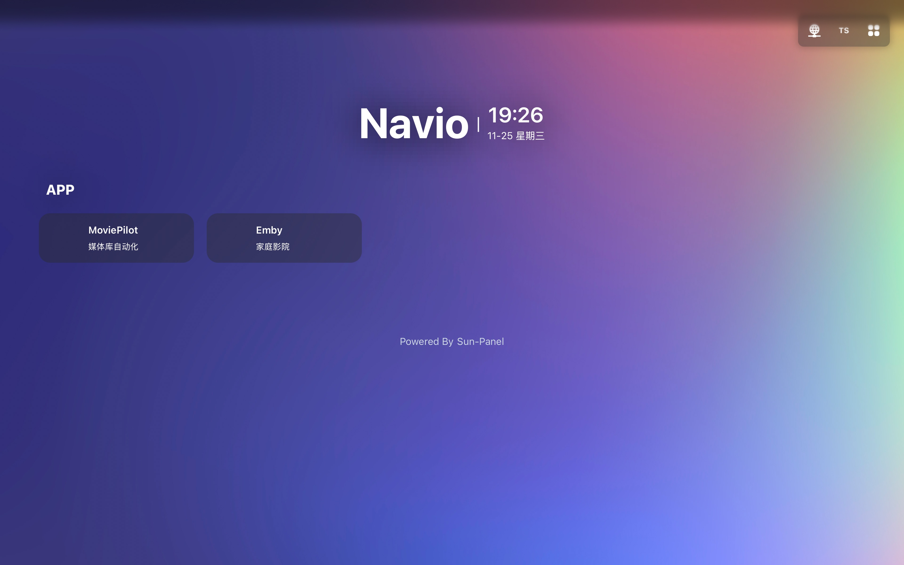
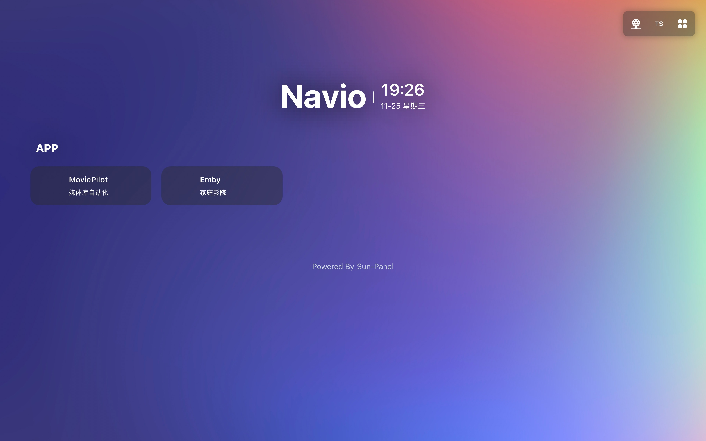

# Navio

**Navio** 是一个自托管的家庭导航面板 —— 基于 [hslr-s/sun-panel](https://github.com/hslr-s/sun-panel)（MIT）二次开发，
在保留其核心体验的同时，补齐了图库、公开图库、备份迁移，并内置了「网络位置探针」：
无论你在家、走 Tailscale，还是在外面，卡片都会自动选择最快的内网/远程地址。

**Navio is a self-hosted home navigation panel** — a fork of [hslr-s/sun-panel](https://github.com/hslr-s/sun-panel) (MIT)
with gallery, public gallery, backup & migration built in, plus a **network location probe**
so cards automatically pick the fastest LAN / Tailscale / WAN address.

## 功能亮点 / Highlights

- 内外网自动切换：https 页面下也能判断 内网 / Tailscale / 外网
- 图库 & 公开图库（原 PRO 功能，本版内置）
- 备份与迁移（整库 zip）
- 通用文件管理（任意文件上传、外链）
- 证书：内置 ACME（DNS-01，当前支持 Cloudflare），自动续期，无需外部容器
- Docker 单镜像部署

## 截图 / Screenshots

| 首页 / Home | 系统应用 / System apps |
|---|---|
|  |  |

## 快速开始 / Quick start

```yaml
services:
  navio:
    image: ghcr.io/a454735639-lab/navio:latest
    container_name: navio
    ports:
      - "3002:3002"   # 面板
      - "8443:8443"   # 可选：网络探针（TLS）
    volumes:
      - ./conf:/app/conf
```

内网自动判定（可选）需要两条灰云 DNS 记录 + 证书，详见 [docs/NETWORK-PROBE.md](docs/NETWORK-PROBE.md)。

## 版权与许可 / License & attribution

- 本项目基于 [hslr-s/sun-panel](https://github.com/hslr-s/sun-panel) 二次开发，感谢原作者。
- 原项目与本仓库均采用 [MIT License](LICENSE)，版权归各自作者所有。
- "Sun-Panel" 名称与商标归原项目所有；本项目为独立分支，使用独立名称 **Navio**。
